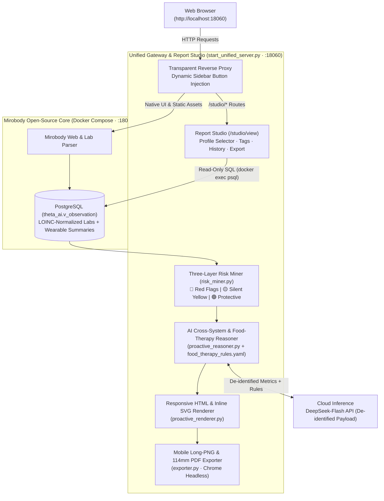
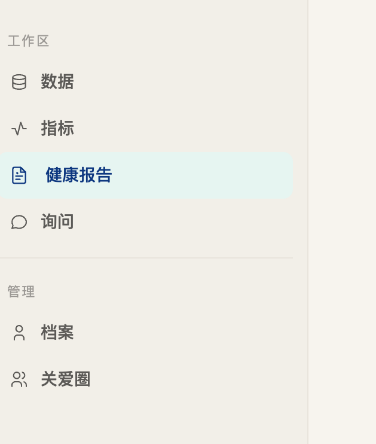

# Mirobody-Health · Personal Health Data Hub × AI Proactive Risk Mining & Food-Therapy Report Engine

[](https://www.python.org/)
[](./generate_from_mirobody.py)
[](./LICENSE)
[](https://platform.deepseek.com/)
[](./start_unified_server.py)

[简体中文](./README.md) | **English**

> [!IMPORTANT]
> **Medical Disclaimer & Project Scope (Please Read First)**
> 1. **Not Medical Advice**: All risk alerts, plain-language lab explanations, food-therapy traffic-light lists, and follow-up suggestions generated by this project are **strictly for technical research, personal health record organization, and doctor-visit preparation**. They do **not** constitute medical diagnosis, clinical prescriptions, or treatment advice. Always consult a qualified physician for abnormal results or symptoms.
> 2. **Hobby Project Maintenance Boundary**: This is a personal hobby project provided **"AS-IS"** with no commercial SLA. I cannot offer 1-on-1 debugging for individual hospital lab templates, though Pull Requests are warmly welcome.
> 3. **Localization Note**: The current web UI, LLM prompt templates, and Medicine-Food Homology rule set are authored in **Chinese** (tailored to Chinese hospital checkup reports and TCM dietary concepts). The underlying zero-invasive proxy architecture and deterministic risk-mining engine are language-agnostic and easy to adapt.

---

## Why I Built This (4 Real Pain Points with Annual Checkups)

Sitting down with a thick stack of annual checkup PDFs and loose lab slips from different hospitals usually ends in four frustrations:

1. **Jargon Overload**: Pages packed with abbreviations (`LDL-C`, `HbA1c`, `GGT`, `eGFR`) and a rushed 3-minute consultation ("Nothing major, just watch your diet") leave most people clueless.
2. **Fragmented Multi-Year History**: Last year's clinic uses `mg/dL`, this year's hospital uses `mmol/L`, and lab item names shift slightly. Nobody connects the **3-year trajectory**—especially silent risks where a metric has **no red flag on paper yet has climbed above 85% of its upper reference limit**.
3. **Blank-Box AI Paralysis**: Dropping raw lab tables into a generic chatbot forces non-doctors to guess what to ask, which usually yields boilerplate advice ("sleep more, drink water, eat light").
4. **Blind Supplement Traps**: Many commercial "AI health reports" exist only to upsell expensive tonics—ignoring the fact that sugary bird's nest or rich herbal pastes can actually worsen high triglycerides or borderline blood glucose.

**Mirobody-Health** pairs the open-source [Mirobody](https://github.com/thetahealth/mirobody) standardized health data hub with a **zero-invasive sidecar gateway**. Without forcing users to write a single prompt, it mines silent risks across years and turns them into a **mobile-readable report with plain-English takeaways and a ready-to-read checklist for your next doctor visit**.

---

## Five Core Highlights

### 1. Zero-Invasive Reverse Proxy Gateway (No Upstream Fork Needed)
* **Zero modifications to Mirobody's source repository**: Keep pulling upstream `thetahealth/mirobody` updates cleanly without merge conflicts.
* An external Python reverse proxy [`start_unified_server.py`](./start_unified_server.py) listens on `:18060`, transparently proxies the Mirobody container on `:18061`, and injects a native-styled **「健康报告」(Health Report)** navigation entry directly into the sidebar DOM—switching the main viewport seamlessly into the Report Studio workspace (`/studio`).

### 2. 100% Pure Python Standard Library (Zero `pip install`)
* The entire core pipeline—reverse proxy gateway, read-only PostgreSQL access via `docker exec psql`, three-layer risk miner, DeepSeek API client, inline SVG trend charts, and HTML report renderer—runs exclusively on **Python's built-in standard library**.
* Mobile-optimized long PNG and 114 mm wide PDF exports ([`src/exporter.py`](./src/exporter.py)) require no external Python packages either; they invoke local Google Chrome / Chromium Headless directly so reports read cleanly on phones without pinch-zooming.

### 3. Three-Layer Proactive Risk Mining Engine (Catching Unflagged Silent Risks)
Deterministic pre-screening in [`src/risk_miner.py`](./src/risk_miner.py) combined with LLM cross-system synthesis:
* **Layer 1 · 🔴 Explicit Red Flags**: Out-of-range lab values and abnormal qualitative/imaging findings (e.g., fatty liver, thyroid nodules).
* **Layer 2 · 🟡 Silent Borderline Yellow Flags**: Catches metrics still marked "normal" on hospital slips that sit at **82%–85%+ of the reference ceiling**, cross clinical early-warning cutoffs (e.g., `HbA1c >= 5.7%`, `eGFR < 90`), or drift **≥ 10% across checkup dates**.
* **Layer 3 · 🔗 Cross-System Root-Cause Chains**: Groups scattered labs by medical system into clear cause-and-effect axes and automatically renders **inline SVG sparklines** with dashed reference-limit lines.

### 4. "Guardrails First, Nourishment Second" Traffic-Light Engine
* Grounded by a deterministic YAML rule base ([`rules/food_therapy_rules.yaml`](./rules/food_therapy_rules.yaml)) restricted to official Medicine-Food Homology ingredients.
* Evaluates four common wellness categories (Bird's Nest, Ginseng/Cordyceps, Ejiao/Pastes, Daily Herbal Teas): **red-light warnings first** to save money and prevent adverse reactions, followed by gentle **green-light daily pairings**.
* Ends with **"Questions to Ask Your Doctor Next Visit"** and a **Verification Recheck Timeline** to close the loop with objective lab tests.

### 5. Local-First Data Sovereignty × Pennies per Run × Apple Watch Cross-Check
* All raw PDFs, lab photos, and PostgreSQL time-series data stay on your own machine (Mac / NAS / private server). Names and IDs are stripped locally before calling cloud inference.
* Standardized on a single **`DeepSeek-Flash`** API endpoint—no local GPU required, costing roughly **\$0.01–\$0.03 per full multi-year report**.
* Aggregates multi-year **Apple Watch / Apple Health** metrics (daily steps, resting HR, HRV, sleep duration, body mass) from Mirobody to cross-check lifestyle trends against lab shifts with 4-year SVG sparklines.

---

## System Architecture



---

## Visual Previews

*(Note: Screenshots below reflect the current Chinese UI and are generated strictly from a synthetic, de-identified demo profile.)*

### 1. Zero-Invasive Sidebar Integration
Native-style **「健康报告」(Health Report)** entry injected into Mirobody's sidebar without editing a single line of upstream frontend code:

<p align="center">
  
</p>

### 2. Mobile-First Report Output (Synthetic Demo Profile)
Executive verdict → Silent borderline callout → Cross-system pain points with inline SVG lab trends → Protective anchors → Apple Watch multi-year cross-check → System traffic lights → Food-therapy guardrails → Doctor-visit questions → Recheck timeline:

<details>
<summary>Click to expand full 430px mobile long-PNG preview (synthetic demo dataset)</summary>

<p align="center">
  
</p>

</details>

---

## 10-Second Quick Demo (No Docker · No API Key)

The repository ships with a synthetic 3-year checkup + Apple Watch dataset ([`src/demo_data.py`](./src/demo_data.py) and [`food_therapy_demo/data/mock_checkups.json`](./food_therapy_demo/data/mock_checkups.json)). With zero `pip install` steps, you can run the real Three-Layer Risk Miner and HTML/SVG renderer in one second:

```bash
git clone https://github.com/liwen-cn/mirobody-health.git
cd mirobody-health

# Offline mode: runs real 3-layer mining + pre-synthesized report JSON and opens it in your browser
python3 generate_from_mirobody.py --demo --open
```

To test live DeepSeek-Flash reasoning against the synthetic demo dataset:

```bash
cp .env.example .env
# Edit .env and set your DEEPSEEK_API_KEY
python3 generate_from_mirobody.py --demo --demo-live --open
```

Outputs are written to `output/demo_mirobody_report.html` (ignored by Git). To export a mobile long-PNG (requires local Google Chrome / Chromium):

```bash
python3 -c 'from src.exporter import export_mobile_png; export_mobile_png("output/demo_mirobody_report.html")'
```

---

## Full Local Deployment (With Mirobody)

### Prerequisites
* Python 3.9+
* Docker / Docker Compose (OrbStack or Docker Desktop)
* A DeepSeek API Key ([DeepSeek Platform](https://platform.deepseek.com/))
* Google Chrome / Chromium (optional, for mobile PNG/PDF export)

### Setup Steps

**1. Clone the upstream [thetahealth/mirobody](https://github.com/thetahealth/mirobody) base**

```bash
git clone --depth 1 https://github.com/thetahealth/mirobody.git mirobody
```

Follow Mirobody's official setup to initialize its containers and `.env` (expecting default PostgreSQL container `mirobody-pg-1`, or override via `MIROBODY_PG_CONTAINER`).

**2. Configure environment variables**

```bash
cp .env.example .env
# Set DEEPSEEK_API_KEY=sk-xxxxxxxx inside .env
```

**3. Launch the unified gateway**

```bash
chmod +x start.sh stop.sh run.sh
./start.sh
```

The script automatically moves the Mirobody container to internal port `18061` and starts [`start_unified_server.py`](./start_unified_server.py) in the background on `18060`.
Visit **`http://localhost:18060`** and click **「健康报告」** in the sidebar.

To stop the gateway:

```bash
./stop.sh
```

---

## Project Structure

```text
mirobody-health/
├── generate_from_mirobody.py   # End-to-end CLI (supports --demo offline/live and Mirobody PG pipeline)
├── start_unified_server.py     # Unified reverse proxy (:18060) + sidebar JS injection + Report Studio
├── report_studio.py            # Standalone lightweight local web studio (:18065)
├── start.sh / run.sh / stop.sh # Background daemon start / restart / stop helpers
├── .env.example                # Environment template (never commit real .env files)
├── rules/
│   └── food_therapy_rules.yaml # Deterministic Medicine-Food Homology traffic-light rule base
├── src/
│   ├── mirobody_reader.py      # Read-only PostgreSQL extractor (labs, meds, Apple Watch summaries)
│   ├── risk_miner.py           # Three-layer proactive risk mining engine
│   ├── proactive_reasoner.py   # DeepSeek-Flash prompt & JSON schema synthesis with retry fallback
│   ├── proactive_renderer.py   # Mobile-responsive HTML & inline SVG sparkline renderer
│   ├── exporter.py             # Zero-dependency Chrome Headless mobile PNG & 114mm PDF exporter
│   ├── demo_data.py            # Synthetic dataset loader & offline report payload for --demo
│   └── api_client.py           # Pure-stdlib DeepSeek API client
├── food_therapy_demo/          # Early standalone prototype (includes mock_checkups.json)
└── docs/assets/                # De-identified preview images for README
```

---

## Acknowledgments & License

* Built on top of **[thetahealth/mirobody](https://github.com/thetahealth/mirobody)** — grateful to the Mirobody team for open-sourcing the medical document parser, LOINC/UCUM normalization engine, and wearable health data hub.
* Released under the **[MIT License](./LICENSE)**.
