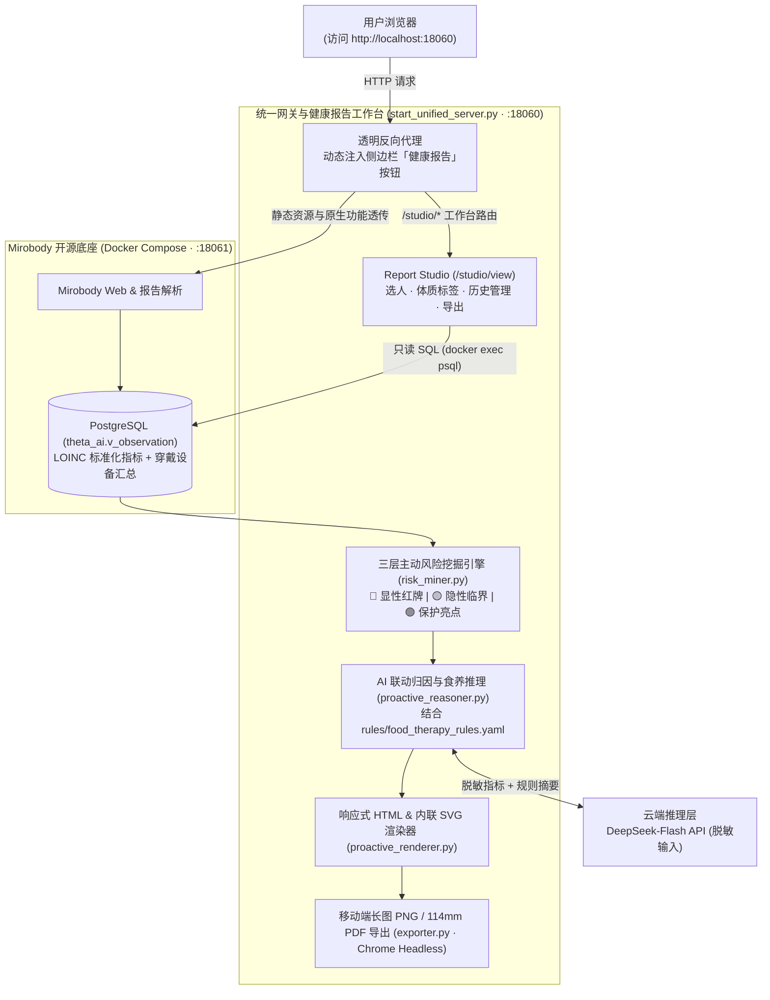
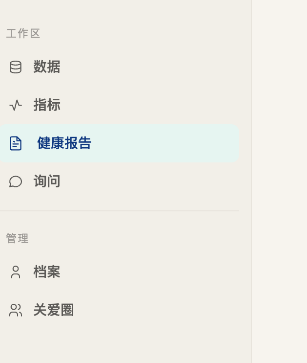

# Mirobody-Health · 个人健康数据中枢 × AI 主动风险挖掘与食养报告引擎

[](https://www.python.org/)
[](./generate_from_mirobody.py)
[](./LICENSE)
[](https://platform.deepseek.com/)
[](./start_unified_server.py)

**简体中文** | [English](./README.en.md)

> [!IMPORTANT]
> **医疗合规与个人项目免责声明（请务必阅读）**
> 1. **非医疗建议**：本项目生成的任何风险提示、指标通俗解读、药食同源红绿灯清单与复查建议，**仅作技术研究、个人健康数据整理与就医沟通参考，不构成任何医疗诊断、处方或用药依据**。任何异常或不适，请及时前往正规医疗机构遵医嘱诊治。
> 2. **业余开源维护边界**：本项目为作者业余兴趣实践的开源作品，代码按“现状（AS-IS）”提供，**不承诺商业级 SLA，亦无法针对个人医院特定格式化验单提供一对一调试答疑**，欢迎通过 Pull Request 共同完善。

---

## 为什么做这个项目？（普通人看体检报告的 4 个无力感）

拿到厚厚一叠体检单和几年前的化验单，大家常遇到四个窘境：

1. **看不懂**：满纸英文缩写（`LDL-C`、`HbA1c`、`GGT`、`eGFR`），医生 3 分钟看完说“注意饮食”，回家依然一脸茫然。
2. **连不起来**：前年体检中心、去年三甲医院、今年社区医院，同一项指标叫法和单位都不同，没人帮你把 **3 年的变化趋势** 串成一条线，更没人发现 **“虽未标红箭头、却已连续三年逼近上限 85%”** 的沉默风险。
3. **不知道怎么问 AI**：就算把体检单扔进通用聊天机器人，普通人不是医生，面对空白输入框根本不知道从何问起，结果往往只得到“少熬夜、多喝水、清淡饮食”的正确废话。
4. **滋补品瞎吃踩坑**：市面上不少所谓的健康解读最后都在硬推高价补品——殊不知血脂和血糖偏高时，乱吃冰糖燕窝、厚腻阿胶膏方反而可能火上浇油。

**Mirobody-Health** 的思路是：**底层接入开源的 [Mirobody](https://github.com/thetahealth/mirobody) 标准化健康中枢，外挂一套零源码侵入的「三层主动风险挖掘 + 药食同源红绿灯」工作台**——不用学复杂提问词，一键生成一份**普通人 15 秒就能看懂核心重点、带着去医院照着念给医生听的手机端健康报告**。

---

## 五大核心亮点

### 1. 非侵入式透明网关：零源码修改融入原生界面
* 不魔改 Mirobody 官方源码、不维护艰难的 Fork 分支，上游随时可 `git pull` 升级。
* 通过外置统一反向代理网关 [`start_unified_server.py`](./start_unified_server.py)（监听 `18060`，透传 `18061` 原生容器），在传输层动态注入原生风格侧边栏按钮 **「健康报告」**，点击即可在原界面内部无缝切换至 Report Studio 工作台。

### 2. 100% 纯 Python 标准库（连 `pip install` 都不需要）
* 核心运行链路（网关代理、PostgreSQL `docker exec` 读取、三层风险挖掘、DeepSeek API 调用、内联 SVG 趋势图渲染、HTML 报告生成）**完全使用 Python 标准库实现，零第三方依赖**。
* 手机高清长图 PNG 与手机宽屏 PDF 导出（[`src/exporter.py`](./src/exporter.py)）同样零依赖直调本地 Chrome / Chromium Headless 完成排版，微信里发长图或 PDF 免缩放直读。

### 3. 三层主动风险挖掘引擎（专门揪出“未标红”的沉默风险）
基于 [`src/risk_miner.py`](./src/risk_miner.py) 确定性规则引擎预筛 + 大模型联动推理：
* **第一层 · 🔴 显性异常红牌**：直接超出参考范围的化验项，以及超声/CT/心电图等影像定性异常。
* **第二层 · 🟡 隐性临界黄牌**：把**尚在正常区间但已逼近上限 82%–85% 以上**（如空腹血糖 5.96、尿酸 412）、触发临床早期警戒线（如 `HbA1c ≥ 5.7%`、`eGFR < 90`），或跨年变化幅度 ≥ 10% 的指标提前拎出来预警。
* **第三层 · 🔗 跨系统联动痛点轴**：拒绝把报告写成“指标流水账”，自动将分散在不同科室的指标串联成因果链（并自动内联渲染带有红色参考上限虚线的 **跨年 SVG 指标折线图**）。

### 4. 「先排雷，再滋补」的药食同源红绿灯机制
* 内置结构化规则库 [`rules/food_therapy_rules.yaml`](./rules/food_therapy_rules.yaml)，严格限定食材范围（参照国家卫健委《按照传统既是食品又是中药材的物质目录》）。
* 针对 **燕窝与滋阴、参类与虫草、阿胶与膏滋、药食同源日常茶饮** 四大品类：**先亮红灯帮用户避坑省钱，再给温和具体的日常搭配建议**。
* 报告末尾附带 **「下次复查直接照着问医生的精准清单」** 与 **「复查倒计时计划」**，形成可验证的闭环。

### 5. 数据主权本地可控 × 极低单次成本 × 穿戴趋势交叉印证
* 所有体检原始 PDF/图片与 PostgreSQL 时序指标库均留在本地（Mac / NAS / 私有主机），发往云端模型前剥离真实姓名与身份证号，仅传递脱敏代号与指标数值。
* 全链路统一对接 **`DeepSeek-Flash`** 单一 API，无需本地重型 GPU，一套体检提取 + 深度推理报告生成成本约 **¥0.05 ～ 0.20**。
* 支持读取 Mirobody 中的 **Apple Watch / Apple Health** 多年穿戴日均值（步数、静息心率、HRV、睡眠、体重），与化验单指标交叉印证并绘制 4 年趋势 SVG 图表。

---

## 系统架构设计



---

## 效果预览

### 1. 侧边栏非侵入式无缝集成
无需修改 Mirobody 一行前端代码，在原生工作区菜单中自然融入 **「健康报告」** 入口：

<p align="center">
  
</p>

### 2. 移动端适配报告效果（基于内置脱敏虚拟样本「林先生」生成）
包含 **一屏核心结论 → 隐性早筛提醒 → 跨系统串联排雷（带 SVG 指标趋势图）→ 保护亮点 → Apple Watch 穿戴交叉印证 → 分系统红绿灯 → 四大品类食养红绿灯 → 问医生清单 → 复查计划**：

<details>
<summary>点击展开完整手机端高清长图预览（430px 宽度直出，基于完全虚拟脱敏样本）</summary>

<p align="center">
  
</p>

</details>

---

## 10 秒极速体验（无需 Docker · 无需 API Key）

项目内置了完全脱敏的虚拟 3 年体检 + Apple Watch 模拟数据集（[`src/demo_data.py`](./src/demo_data.py) 与 [`food_therapy_demo/data/mock_checkups.json`](./food_therapy_demo/data/mock_checkups.json)）。不需要安装任何第三方 Python 包，直接克隆即可 1 秒跑通完整的「三层主动风险挖掘引擎 + SVG 图表渲染」：

```bash
git clone https://github.com/liwen-cn/mirobody-health.git
cd mirobody-health

# 离线模式：1 秒跑通三层风险挖掘与 HTML 报告渲染，并自动在浏览器打开
python3 generate_from_mirobody.py --demo --open
```

如果你想使用演示样本**实时调用 DeepSeek-Flash** 体验 AI 现场推理，只需配置 Key 后加上 `--demo-live`：

```bash
cp .env.example .env
# 编辑 .env，填入您的 DEEPSEEK_API_KEY
python3 generate_from_mirobody.py --demo --demo-live --open
```

生成结果默认保存在 `output/demo_mirobody_report.html`（已配置 `.gitignore` 自动忽略）。如果需要导出手机长图或 114mm 窄幅 PDF（需本机已安装 Google Chrome / Chromium）：

```bash
python3 -c 'from src.exporter import export_mobile_png; export_mobile_png("output/demo_mirobody_report.html")'
```

---

## 完整本地部署（接入 Mirobody 真实数据中枢）

### 前置依赖
* Python 3.9+
* Docker / Docker Compose（推荐使用 OrbStack 或 Docker Desktop）
* DeepSeek API Key（[DeepSeek 开放平台](https://platform.deepseek.com/)）
* Google Chrome / Chromium（仅在使用一键导出手机 PNG/PDF 时需要）

### 部署步骤

**1. 拉取上游开源底座 [thetahealth/mirobody](https://github.com/thetahealth/mirobody)**

```bash
git clone --depth 1 https://github.com/thetahealth/mirobody.git mirobody
```

按 Mirobody 官方说明完成基础初始化（配置模型 Key 与数据库容器），确保 Docker 容器名默认为 `mirobody-pg-1`（或通过环境变量 `MIROBODY_PG_CONTAINER` 指定）。

**2. 配置本项目的环境变量**

```bash
cp .env.example .env
# 在 .env 中填入 DEEPSEEK_API_KEY=sk-xxxxxxxx
```

**3. 一键启动统一网关与健康报告工作台**

```bash
chmod +x start.sh stop.sh run.sh
./start.sh
```

脚本会自动将 Mirobody 调度至内部端口 `18061`，并在后台守护启动 [`start_unified_server.py`](./start_unified_server.py) 监听 `18060`。
打开浏览器访问：**`http://localhost:18060`**，在左侧边栏点击 **「健康报告」** 即可开始使用！

停止服务：

```bash
./stop.sh
```

---

## 目录结构

```text
mirobody-health/
├── generate_from_mirobody.py   # 端到端 CLI 入口（支持 --demo 零依赖体验与真实 Mirobody 管线）
├── start_unified_server.py     # 统一反向代理网关（:18060）+ 侧边栏 JS 注入 + Report Studio
├── report_studio.py            # 独立轻量本地报告工作台（:18065）
├── start.sh / run.sh / stop.sh # 一键启动 / 重启 / 停止守护脚本
├── .env.example                # 环境变量模板（切勿提交真实 .env）
├── rules/
│   └── food_therapy_rules.yaml # 药食同源红绿灯确定性规则知识库
├── src/
│   ├── mirobody_reader.py      # 从 Mirobody PostgreSQL 只读抽取标准化指标、用药与穿戴趋势
│   ├── risk_miner.py           # 三层主动风险挖掘引擎（红牌 / 临界黄牌 / 跨期趋势 / 保护亮点）
│   ├── proactive_reasoner.py   # DeepSeek-Flash 结构化深度推理 Prompt 与 JSON 容错重试
│   ├── proactive_renderer.py   # 自适应 HTML 报告 & 内联 SVG 指标/穿戴折线图渲染器
│   ├── exporter.py             # 零依赖 Chrome Headless 手机长图 PNG / 114mm PDF 导出器
│   ├── demo_data.py            # --demo 脱敏虚拟数据加载器与离线合成结果
│   └── api_client.py           # 纯标准库 DeepSeek API 客户端
├── food_therapy_demo/          # 早期独立轻量原型小样（含 mock_checkups.json 脱敏数据）
└── docs/assets/                # README 脱敏效果展示截图
```

---

## 致谢与协议

* 本项目站在优秀开源项目 **[thetahealth/mirobody](https://github.com/thetahealth/mirobody)** 的肩膀上构建，致谢 Mirobody 团队提供的医疗文档解析、LOINC/UCUM 标准化引擎与穿戴健康数据基座。
* 本仓库代码基于 **[MIT License](./LICENSE)** 开源。
